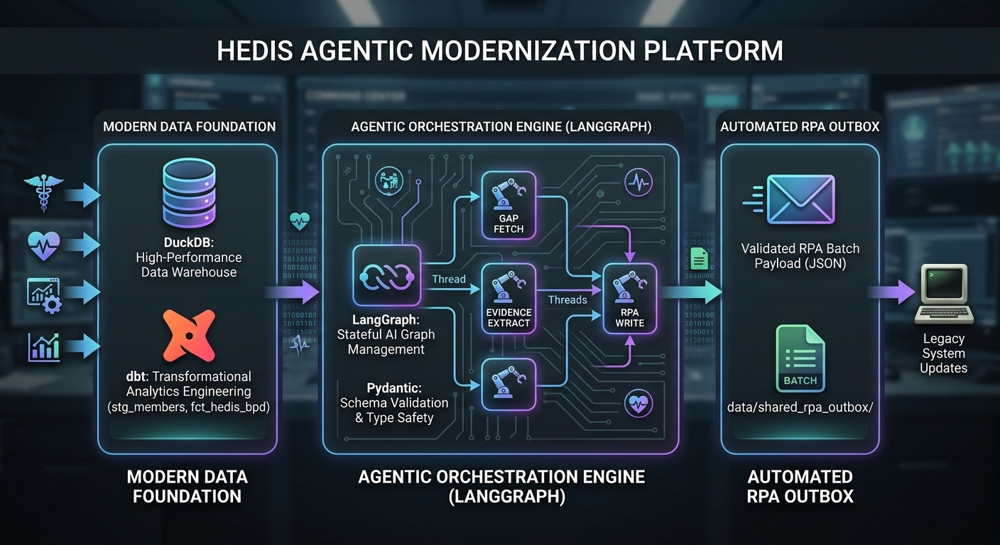

# 🩺 HEDIS Agentic Data & Orchestration Pipeline



A production-grade Healthcare Effectiveness Data and Information Set (HEDIS) automation pipeline built with **DuckDB**, **dbt**, **LangGraph**, **Pydantic**, and a decoupled **RPA Outbox pattern**. This project automates the extraction, clinical evidence identification, and closure workflows for quality-of-care gaps.

---

## 🏗️ Architecture & Tech Stack

```
[DuckDB / dbt Marts] ──> [LangGraph State Machine] ──> [Pydantic Validation] ──> [RPA Outbox JSON]
 (`fct_hedis_bpd`)         (MemorySaver Checkpoint)      (CareGap Schemas)        (`data/shared_rpa_outbox/`)
```

* **Data Warehouse & Transformation:** DuckDB managed via dbt models (`stg_members`, `stg_claims`, `fct_hedis_bpd`) for high-performance analytical modeling.
* **Orchestration & State Management:** LangGraph state graph utilizing a `MemorySaver` checkpointer for reliable multi-step execution.
* **Schema Validation & Typing:** Pydantic (`BaseModel`) enforcing strict immutability, data cleanliness, and type safety across nodes.
* **Downstream Integration:** Asynchronous RPA outbox handoff dropping serialized JSON payloads into a shared directory for legacy UI bot consumption (e.g., EZCAP).

---

## 📁 Project Structure

```text
hedis-agentic-pipeline/
├── hedis_engine/
│   ├── nodes/
│   │   ├── gap_fetcher.py      # Pulls unclosed care gaps from DuckDB/dbt mart
│   │   ├── extractor.py        # Parses & extracts clinical evidence values
│   │   └── rpa_writer.py       # Serializes validated payloads to the RPA outbox
│   ├── schemas/
│   │   └── hedis_types.py      # Pydantic models (CareGap, HedisState)
│   └── main.py                 # LangGraph workflow definition & CLI entrypoint
├── models/                     # dbt models and SQL transformations
├── data/
│   ├── hedis.duckdb            # Local DuckDB data warehouse
│   └── shared_rpa_outbox/      # Generated JSON payloads ready for RPA ingestion
├── pyproject.toml              # Project dependencies and CLI entry point script
└── README.md
```

---

## 🚀 Quickstart & Installation

1. **Clone the repository and set up a virtual environment:**
   ```bash
   git clone https://github.com/JC-Tech-Solutions/hedis-agentic-pipeline.git
   cd hedis-agentic-pipeline
   python3 -m venv .venv
   source .venv/bin/activate
   ```

2. **Install dependencies and CLI command:**
   ```bash
   pip install --editable .
   ```

3. **Run the pipeline:**
   ```bash
   hedis-run
   ```

---

## 🤖 Pipeline Workflow

1. **Fetch Gaps (`gap_fetcher`):** Queries the DuckDB `fct_hedis_bpd` table for unclosed HEDIS care gaps.
2. **Extract Evidence (`extractor`):** Evaluates measure codes (e.g., Blood Pressure Control - BPD) and populates clinical evidence values.
3. **Write Outbox (`rpa_writer`):** Validates the Pydantic schema and writes out a clean, structured JSON payload to `data/shared_rpa_outbox/`.

---

## 🛡️ License
Distributed under the MIT License. See `LICENSE` for more information.